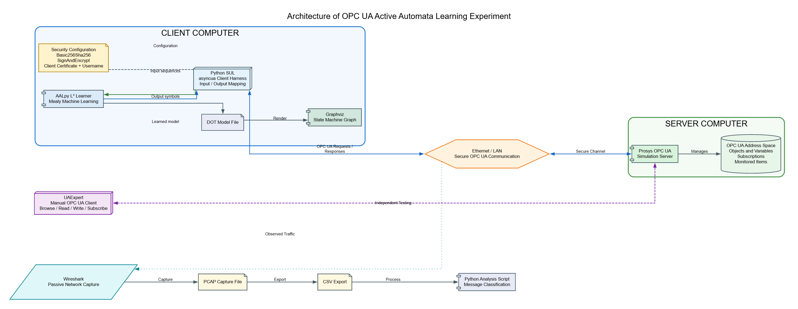

# OPC UA Protocol Inference and State Machine Learning

**Project:** Peer Project (10 CP)\
**Institution:** Hochschule Emden/Leer\
**Programme:** M.Sc. Industrial Informatics\


## 1. Overview

This repository collects the source code, packet captures, processed
data, learned models, visualisations, experiments, and documentation for
the project **Protocol Inference and State Machine Learning of the OPC
UA Protocol from Network Traces**.

The project investigates how OPC UA protocol behaviour can be
represented as a finite-state model using network-traffic analysis and
automata-learning techniques.




The proposed workflow includes:

1.  Establishing a controlled OPC UA client/server test environment.
2.  Capturing OPC UA network traffic in PCAP/PCAPNG format.
3.  Preprocessing traffic and extracting OPC UA messages.
4.  Identifying message types and relevant fields.
5.  Mapping concrete messages to an abstract alphabet.
6.  Inferring a state-machine model from observed behaviour.
7.  Validating and documenting the model.

This repository also contains an active-learning implementation using
AALpy. **Models inferred from recorded PCAP traces and models learned
through active interaction with an OPC UA server are distinct results
and should be labelled separately.**

## 2. Objectives

-   Define the OPC UA services and behaviours included in the
    experiments.
-   Create repeatable client/server interaction scenarios.
-   Capture and analyse traffic using Wireshark and related tools.
-   Extract OPC UA messages from packet captures.
-   Develop an abstraction from concrete messages to symbols.
-   Investigate passive inference from recorded traces.
-   Use AALpy for active learning and model refinement where applicable.
-   Visualise state machines using Graphviz.
-   Validate models against additional traces and/or a separate OPC UA
    server.
-   Document assumptions, limitations, and results.

## 3. Experimental Environment

The experimental work has involved the following components. Update this
table to reflect the final setup.

  -----------------------------------------------------------------------
  Component                           Purpose
  ----------------------------------- -----------------------------------
  Prosys OPC UA Simulation Server     Main OPC UA server for experiments

  UaExpert                            OPC UA client for generating and
                                      testing interactions

  Python                              Traffic processing and experiment
                                      automation

  `asyncua`                           Python OPC UA communication library
                                      used by the client harness

  AALpy                               Active automata learning

  Wireshark                           Network traffic capture and
                                      inspection

  Scapy / PyShark                     Python packet processing, where
                                      used

  Graphviz                            State-machine visualisation
  -----------------------------------------------------------------------

### 4. Security configuration

Some experiments use **Basic256Sha256** with **SignAndEncrypt**,
certificate-based secure-channel configuration, and username
authentication.

Encrypted captures may not expose service-level request and response
details unless suitable decryption material and supported analysis are
available. Record which captures are encrypted and which fields can
actually be decoded. Do not assume service names can be recovered from
encrypted payloads.


## 5. Methodology

### 5.1 Traffic generation and capture

Generate repeatable OPC UA scenarios using the selected client and
server. Capture traffic with Wireshark or `tcpdump` and store original
captures in `captures/raw/`.

Suggested scenario categories:

-   Connection establishment and termination
-   Secure-channel and session establishment
-   Address-space browsing
-   Variable reads and writes
-   Subscription and monitored-item operations
-   Reconnection and recovery
-   Invalid operations and error responses

For each capture, record the client/server versions, endpoint, security
policy, message-security mode, authentication method, scenario steps,
and capture date. Do not publish passwords, private keys, or unredacted
credentials.

### 5.2 Packet processing and message extraction

Process captures to identify TCP streams and OPC UA messages. Where
required, handle TCP stream reassembly, OPC UA message boundaries,
message direction, chunking, and request/response correlation.

Record extraction limitations. For encrypted traffic, distinguish fields
visible in packet headers from service-level information that cannot be
decoded.

### 5.3 Message abstraction

Map extracted messages into a documented abstract alphabet. The exact
symbols must be supported by fields available in the captures.

Illustrative transport-level symbols:

``` text
HEL
ACK
OPN
MSG
CLO
ERR
```

Where service-level messages can be decoded, the abstraction may
include:

``` text
BROWSE_REQ
BROWSE_RES
READ_REQ
READ_RES
WRITE_REQ
WRITE_RES
CREATE_SUB_REQ
CREATE_SUB_RES
```

These are examples, not a claim that every symbol is available in every
capture.

### 5.4 Passive inference from traces

Recorded traces provide observed sequences. A passive-learning workflow
can build an initial prefix-based model and use state-merging or another
suitable inference method to generalise beyond the exact recorded
sequences.

Document:

-   How traces are segmented into sessions.
-   How client inputs are distinguished from server outputs.
-   How request/response pairs are correlated.
-   How errors, timeouts, and incomplete traces are represented.
-   Which inference algorithm is used.
-   How the inferred model is evaluated on traces not used for training.

A state machine generated from a single observed trace is only a
representation of that trace; it is not, by itself, evidence of a
complete protocol model.

### 5.5 Active learning with AALpy

The active-learning implementation uses a client-side harness to execute
abstract operations against an OPC UA server and observe normalised
outputs. AALpy can learn a model through membership queries and an
approximate equivalence-testing strategy.

Keep this model clearly identified as **actively learned**. It is
methodologically different from a model inferred solely from recorded
PCAP traces.

### 5.6 Model validation and comparison

Compare the passive trace-derived model with the active AALpy model
where their alphabets and abstraction levels are compatible.

Possible evaluation criteria:

-   Whether held-out traces are accepted or correctly replayed.
-   Whether observed transitions are represented.
-   Whether invalid sequences produce expected error behaviour.
-   Whether repeated experiments produce consistent results.
-   Which states or transitions differ between models.
-   Whether differences arise from abstraction, encryption, missing
    traces, or server-specific behaviour.

## 6. Network Traffic Analysis

Store packet-analysis scripts and outputs separately from raw captures.

For each analysis run, document:

-   Number of capture files processed.
-   Number of packets and recognised OPC UA messages.
-   Message/service categories counted.
-   Incomplete, malformed, or unrecognised records.
-   Whether each capture was encrypted.
-   Filters and exclusions applied.

A previous analysis run included 12 CSV exports and 3,677
parser-recognised entries. These are results from that particular run,
not total network packet counts. Re-run the analysis and update the
figures if the input captures or parser change.


## 7. Limitations to Consider

-   PCAP traces show only interactions that were captured; they do not
    automatically cover all possible protocol behaviours.
-   Encrypted OPC UA payloads can prevent service-level message
    extraction.
-   TCP segmentation, retransmissions, and OPC UA chunking must be
    handled correctly.
-   Request/response correlation can be difficult when captures are
    incomplete or begin mid-session.
-   A passive model may overfit observed traces if there are
    insufficient examples or no held-out validation data.
-   An active learning model depends on the harness, reset behaviour,
    output abstraction, and equivalence-testing strategy.
-   Server specific behaviour should not be presented as a universal OPC
    UA protocol requirement.

## 8. References

Useful starting points:

-   OPC Foundation --- OPC UA specifications:
    https://reference.opcfoundation.org/
-   AALpy --- Active Automata Learning in Python:
    https://github.com/DES-Lab/AALpy
-   Wireshark User's Guide: https://www.wireshark.org/docs/
-   Graphviz documentation: https://graphviz.org/documentation/
-   `asyncua` Python library: https://github.com/FreeOpcUa/opcua-asyncio


------------------------------------------------------------------------

| Project Supervisor | Prof. Patrick Felke | Hochschule Emden/Leer |

| Project Supervisor | Mr. Heiko Schoon | Hochschule Emden/Leer |

**Author:** Altaf Ahmad | Raja Jawad Ali\
**Project:** Protocol Inference and State Machine Learning of the OPC UA
Protocol from Network Traces\
**Institution:** Hochschule Emden/Leer


